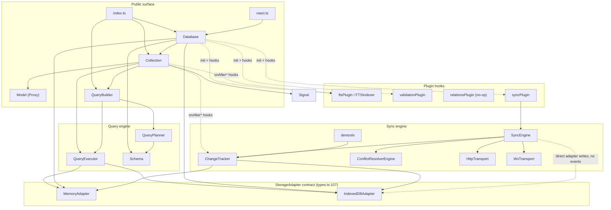

# CTRODB — Phase 1 Engineering Audit

> **Status as of 1.7.2:** every Critical, High and Medium finding in this report
> is closed **except M-14** (schema-derived types, operators and relations are
> still untyped — tracked as the next body of work). All Low/Informational items
> are closed. Each entry carries a `Status:` line with the release that fixed it.
>
> Verified at 1.7.2: 587 tests / 34 files, `npm run verify` clean, package
> declarations checked for node10 / node16 (CJS + ESM) / bundler.

**Repository:** `ctrotech-tutor/ctrodb` · commit `f3193cb` (`main`, 2026-07-02)
**Package version audited:** 1.4.0 · **Audit date:** 2026-10-21
**Auditor stance:** evidence only. No project files were modified, renamed, deleted, or generated. All runtime probes were written to `/tmp` and executed against a local `dist/` build.

---

## Scope, method, and limitations

### What I inspected

- All 34 source files under `src/` (5,037 lines), read end-to-end.
- All 25 test files (3,975 lines), including the Vitest setup and assertions.
- `package.json`, `tsconfig.json`, `tsup.config.ts`, `vitest.config.ts`, `biome.json`, `.npmignore`, `.gitignore`, `.gitattributes`.
- All three GitHub Actions workflows, `CHANGELOG.md`, `README.md`, `CONTRIBUTING.md`, `SECURITY.md`, `ctrodb.md`, `public/`.
- Examples: `examples/node`, `examples/cdn`, `examples/react`, `examples/sync/server-node` (source only).
- GitHub state: open issues (none), open PRs (one), recent workflow runs.

### What I executed

All commands in section D, plus 23 purpose-built runtime probes (listed in the appendix) that reproduce or falsify the hypotheses formed while reading the code.

### Limitations (evidence that could **not** be obtained)

1. **Git history is unavailable.** The checkout is shallow (`git rev-parse --is-shallow-repository` → `true`); only `f3193cb` exists locally with no tags. "Recent commits" are therefore assessed from the single tip commit, GitHub run metadata, and PR #1 — not from a full log review.
2. **No real browser was used.** All IndexedDB behaviour was exercised with `fake-indexeddb@6.2.5` in Node 22.22.3. Where a finding is inherently browser-specific (e.g. `get(undefined)` on an object store, real `blocked`/`versionchange` timing), it is labelled accordingly. Two findings (H-11, H-12) reproduced cleanly under the polyfill; real-browser confirmation is still recommended.
3. **No real sync server was run.** `examples/sync/server-node` dependencies (express/ws) are not installed in the checkout, so the reference server was read but not executed. HTTP/WS transports were assessed from code plus the repository's own mocked tests.
4. **PR #1 CI logs could not be retrieved** (`gh run view --log-failed` returned a transport error from GitHub's log service). The conclusion "CI is failing" is observed; the reason is not.
5. **Tests were run only on Node 22.22.3**, not on Node 20 (the declared engine floor) and not in a browser runner.
6. **Publication was not performed.** `npm publish`/provenance was not executed; packaging was validated by `npm pack` + installation into a throwaway consumer project.

---

## A. Executive assessment

CTRODB is a **real, working, compact library with a coherent design**, not a stub. It builds cleanly in three formats, type-checks under strict settings, lints cleanly, has zero runtime dependencies, no circular imports, a 477-test suite that passes, and genuine engineering investment in the sync engine (status events, backoff, circuit breaker, error-recovery of `syncing` records, devtools). The core abstraction — `Database → Collection → QueryPlanner/Executor → StorageAdapter`, with plugins hooked at record lifecycle boundaries — is sound and worth preserving.

It is, however, **not yet dependable for the use cases it advertises**, for three structural reasons:

1. **The test harness hides the most important failure mode.** `tests/setup.ts` installs `fake-indexeddb/auto` globally, which defines `IDBKeyRange` for every test. Core code calls the browser global `IDBKeyRange` directly (`src/query/planner.ts:128-136`, `src/sync/change-tracker.ts:19,80-83,154,162-176,194`, `src/sync/devtools.ts:51-60,109-112`). Consequently the entire suite passes while **any indexed query, and the entire sync plugin, throws `ReferenceError: IDBKeyRange is not defined` in Node** — the environment the README explicitly supports and auto-selects.
2. **Adapter behaviour diverges in ways that change query results and lose data.** The same call gives different answers on `MemoryAdapter` and `IndexedDBAdapter`: duplicate IDs silently overwrite (memory) versus reject (IDB); `unique: true` is unenforced (memory) versus enforced (IDB); result order and therefore `.limit()` results differ; `db.transaction()` is atomic on memory (via a global snapshot) but **not atomic on IndexedDB** and can silently commit a write that the caller believes was rolled back.
3. **Two headline features are narrower than documented.** Pull is not a safe write path: it can silently overwrite a newer local edit (the only **Critical** finding, and the subject of an open, failing PR), bypasses schema validation, and emits no change events, so reactive UIs do not update. Full-text search is a substring scan in the query builder; the inverted index exists but must be wired manually through the private `_getAdapter()`. Relations and the `relationsPlugin` are partly documentation-only.

Maturity summary: **promising 1.x library with strong bones and a fragile contract.** The fastest path to "dependable" is not a rewrite. It is to (a) make the public write paths (create/update/transaction/pull) have one documented, adapter-independent meaning, (b) make the test environment honest about Node-without-IDB, and (c) align documentation with behaviour. Every structural decision needed to do that incrementally already exists in the codebase.

**Verified strengths** (details in section F): zero runtime dependencies; no import cycles across 34 modules; clean layering (`Database` owns lifecycle, `Collection` owns CRUD/hooks, planner/executor own query compilation, adapters own storage); field-level merge on update prevents lost updates for disjoint fields; sync queue crash recovery (`ChangeTracker.init`); structured response validation for both transports; `sideEffects: false` with an IIFE build.

**Headline verified concerns:** 1 Critical, 15 High, 19 Medium, 15 Low/Informational findings. All High findings are reproduced, not inferred.

---

## B. Architecture map

### Module roles (all paths verified)

| Layer | Modules | Responsibility |
|---|---|---|
| Entry points | `src/index.ts`, `src/react.ts` | Public barrels. `react.ts` is a **separate type graph** (see H-13). |
| Lifecycle | `src/database.ts` | Adapter selection (`src/adapter/create.ts`), connect/disconnect, plugin init, collection cache, global change signal, sync façades. |
| Record API | `src/collection.ts`, `src/model/index.ts` | CRUD, schema defaults/validation, plugin hooks, change emission, eager loading (`with()`), proxy models, lazily-built relation queries. |
| Schema | `src/schema.ts` | Config validation, defaults, type/format checks, index/relation accessors. |
| Query | `src/query/builder.ts` → `planner.ts` → `executor.ts` | Fluent API → `QueryPlan` (`full_scan`/`index_scan`/`id_lookup`, optional OR groups) → adapter call + JS post-filter/sort/limit. |
| Storage | `src/adapter/{memory,idb,create}.ts`, contract in `src/types.ts:107-129` | Two implementations of one interface; transactions; metadata; `scanIndex`. |
| Reactivity | `src/reactive/signal.ts` | Synchronous `Signal<T>` with a subscriber `Set`; per-collection + database-wide signals. |
| Plugins | `src/plugins/{fts,validation,relations}`, `src/utils/plugin-hooks.ts` | Lifecycle hooks (`onBefore/AfterCreate|Update|Delete`, `onDatabaseInit`, `onCollectionInit`). |
| Sync | `src/sync/*` | `syncPlugin` → `SyncEngine` + `ChangeTracker` + `ConflictResolverEngine` + transports + response validators + devtools. |

### Data flow — write

```
Collection.create(data)
  → generate id (crypto.randomUUID)
  → Schema.applyDefaults → Schema.validate          [full replacement for IDB, no-op for schema-less]
  → runHook(onBeforeCreate …)                        [plugins may rewrite data]
  → adapter.create()                                 [memory: Map.set; idb: store.add in its own tx]
  → runHook(onAfterCreate …)                         [sync: ChangeTracker.append; fts: fire-and-forget]
  → collection signal + database signal              [ChangeEvent]
  → Model proxy
```

`Collection.update` reads the existing record **before** the hook and lets the adapter merge `{...existing, ...changes}` at write time. `Collection.delete` reads the record for `oldRecord`, then deletes.

### Data flow — query

```
collection.query() → QueryBuilder
  → schema slice (fields/indexes/searchable/relations)
  → QueryPlanner.plan(conditionGroups, schema, indexes)
      id ==        → id_lookup
      indexed cond → index_scan (best index, IDBKeyRange)
      search cond  → full_scan (search applied in JS)
      groups       → or-plan; each group planned independently
  → QueryExecutor.execute(adapter, …)
      adapter.findAll / scanIndex / findById
      → JS post-filters → sort → offset → limit
  → Collection._toModels → Model proxies
```

### Data flow — sync

```
local mutation → onAfter* hook → ChangeTracker.append (store `_ctrodb_sync_changes`, status=pending)
                                 + BroadcastChannel("ctrodb:sync") post
SyncEngine.sync()
  push: getPending(pending+failed, sorted by timestamp) → markSyncing → transport.push
        → accepted → committed | conflicts → resolver → local/remote/merged | errors → failed
  pull: transport.pull(cursor…) → for each change → #applyRemoteChange → adapter.create/update/delete
        → cursor persisted only after a fully successful cycle → removeCommitted
```

### Boundaries that are enforced vs. only implied

- **Enforced:** adapter methods are awaited before change events; schema validation precedes writes; the planner never hands a `search` condition to `scanIndex`; `ChangeTracker.init()` repairs records left in `syncing`.
- **Only implied:** that `Collection` writes participate in `db.transaction()`; that `pull` is a `Collection` write; that `unique: true` is a constraint; that adapters are interchangeable; that `SyncEngine` is torn down by `db.disconnect()`.
- **Docs claim vs. code:** `relationsPlugin()` is a no-op `{name, version}` object; relations are implemented in `Collection.#eagerLoad*` and `Model.#attachRelationGetters`, and work without the plugin (`src/plugins/relations/index.ts:1-10`).



---

## C. Findings register

Severity: **Critical** = silent data loss/corruption in a supported configuration · **High** = documented behaviour broken or wrong results, no clean workaround · **Medium** = reliability/DX defect with a workaround · **Low/Informational** = hygiene, docs, or optional improvement.
Confidence: **Confirmed** = reproduced by execution · **Strongly indicated** = proven by code path but not executed · **Unverified risk** = environment-dependent.

### Critical

#### C-01 — Sync pull silently overwrites newer local edits
- **Where:** `src/sync/sync-engine.ts:401-477` (`#pullChanges`, `#applyRemoteChange`), called from `sync()` at `218-260`.
- **Evidence (confirmed, probe P22):** a record with a pending local edit (`text = "LOCAL EDIT"`) plus a remote `update` whose timestamp is **60 seconds older** results in `text = "STALE SERVER VALUE"` after `db.sync()`. The queue snapshot afterwards is empty (`{total:0…}`), so nothing will re-push the lost value. `#applyRemoteChange` never consults `ChangeTracker`.
- **Impact:** silent loss of user edits whenever a push is in flight, the device was offline, or two tabs write the same record — the exact scenario an offline-first library exists to prevent. The server can end up with `LOCAL EDIT` while the local store holds `STALE SERVER VALUE`, i.e. permanent divergence.
- **Action:** in `#pullChanges`, snapshot pending/failed changes per `(collection, recordId)`; skip a remote change when it is strictly older than the local pending change; otherwise record remote-wins and mark the superseded change committed. This is what PR #1 proposes; see G.
- **Backward compatibility:** no API change. Behavioural change: apps will stop seeing lost edits; `pull` will perform one extra queue read.

### High

#### H-01 — Indexed queries throw in Node (and any environment without `IDBKeyRange`)
- **Where:** `src/query/planner.ts:124-139` (`IDBKeyRange.only/lowerBound/upperBound`); range crosses the adapter boundary as an `IDBKeyRange` (`src/types.ts:62,123`).
- **Evidence (confirmed, probe P1):** after `db.connect()` on Node 22 with `adapter: "memory"`, `users.query().where("age", ">=", 21).fetch()` throws `ReferenceError: IDBKeyRange is not defined`; the same query on a non-indexed field works. The project's own perf probe crashed at the same line.
- **Impact:** any schema declaring `indexes` plus a `where()` on an indexed field breaks in Node — including server-side usage, CLIs, and tests that do not globally install fake-indexeddb. This is the default adapter in Node (`src/adapter/create.ts:9-13`) and the documented Node story.
- **Action:** introduce a small, storage-neutral range descriptor (e.g. `{ lower, upper, lowerOpen, upperOpen }`) plus an adapter method/property to materialise `IDBKeyRange` only inside the IDB adapter. Keep the helper as an internal detail.
- **Backward compatibility:** `QueryPlan.range` is a public exported type (`range?: IDBKeyRange`). Widening it to a union or keeping `IDBKeyRange` alongside a portable descriptor can stay source-compatible; changing it outright is a breaking type change and needs a minor-version note.

#### H-02 — The sync plugin cannot initialise in Node for the same reason
- **Where:** `src/sync/change-tracker.ts:19,80-83,154,162-176,194`; `src/sync/devtools.ts:51-60,109-112`.
- **Evidence (confirmed, probe P2):** `new Database({ adapter: "memory", plugins: [syncPlugin({transport})] })` → `connect()` rejects with `ReferenceError: IDBKeyRange is not defined`. `ChangeTracker.init()` is called from `SyncEngine.init()` during `onDatabaseInit`.
- **Impact:** the sync engine — a headline feature — is unusable in Node without a browser-API polyfill. In browsers it works, so this is invisible to the maintainers' own suite (D, M-1).
- **Action:** same portable-range work as H-01; `ChangeTracker` should filter by status through the adapter contract, not through a browser global. Add a Node test run with no `fake-indexeddb` in setup.
- **Backward compatibility:** none.

#### H-03 — `db.transaction()` is atomic on memory but **not** on IndexedDB
- **Where:** `src/database.ts:133-136` → `IndexedDBAdapter.transaction` at `src/adapter/idb.ts:276-289`; `MemoryAdapter.transaction` at `src/adapter/memory.ts:150-158`.
- **Evidence (confirmed, probes P15/P7):**
  - `db.transaction(async () => { await accounts.create({...}); throw new Error("boom") })` on **indexeddb**: the transaction rejects with `InvalidStateError` (masking `boom`) and the created row **persists**.
  - The same sequence on **memory** rolls back — because the adapter restores a whole-store snapshot, not because of transaction semantics.
  - `transaction()` resolves as soon as the callback resolves; `tx.oncomplete` is never awaited (`idb.ts:281-288`), so a resolved transaction does not mean committed.
- **Impact:** callers cannot rely on the documented atomicity ("Run in transaction", README API table). Multi-step invariants (balances, counters, cascades) can be half-applied. Using a timer/`fetch`/`await` of a non-IDB promise inside the callback aborts the transaction (`InvalidStateError`) — a trap that is easy to hit in real code.
- **Action:** either (a) implement transactions properly — route operations through the transaction context, keep the IDB transaction alive by issuing all requests from one microtask chain, and resolve only on `tx.oncomplete`; or (b) narrow the contract: rename/document it as a low-level adapter transaction, keep `Collection` writes outside, and expose no false guarantee. Option (a) is preferable and feasible but requires `Collection` to accept an operation context.
- **Backward compatibility:** (b) is documentation + additive; (a) changes timing (resolves after commit) but not source shape.

#### H-04 — Memory transactions cannot be used through the documented context API
- **Where:** `src/adapter/memory.ts:202-212` (`MemoryTransactionContext.collection()` returns the **adapter itself**) vs. `src/adapter/idb.ts:328-346` (returns a scoped `{create, findById, findAll, update, delete}`).
- **Evidence (confirmed, probe P11):** `await db.transaction(ctx => ctx.collection("tasks").create({id:"x", title:"x"}))` on memory throws `TypeError: Cannot read properties of undefined (reading 'id')`, because the raw adapter's `create(collection, data)` receives the record as `collection`. On IndexedDB the same code works.
- **Impact:** adapter-level divergence in a public API; memory-based tests do not represent production behaviour; users following the (implicit) contract hit a type error at runtime despite TypeScript accepting it (`TransactionContext.collection()` returns `unknown`).
- **Action:** give `MemoryAdapter` the same scoped context object; type `TransactionContext.collection()` properly.
- **Backward compatibility:** additive for memory; typing the return value is a (welcome) type-level tightening.

#### H-05 — Memory transaction rollback destroys unrelated concurrent writes
- **Where:** `src/adapter/memory.ts:150-158,183-199` (whole-store snapshot/restore, no locking).
- **Evidence (confirmed, probe P11):** transaction A writes `slow`, waits 20 ms; while it waits, transaction-free code creates `other`; A throws; after rollback the store contains only `pre` — `other` is gone.
- **Impact:** lost writes under normal async interleaving. Memory is the recommended adapter for tests, so tests can pass/fail nondeterministically, and the adapter is also the Node default.
- **Action:** either serialise transactions (mutex/queue) and journal per-operation undo records instead of a global snapshot, or document that `transaction()` on memory is a best-effort snapshot and exclude concurrent writes. A per-operation undo journal is the smaller, safer change.
- **Backward compatibility:** none for correct usage; concurrent-write behaviour changes (for the better).

#### H-06 — Adapter divergence: duplicate IDs and unique indexes
- **Where:** `src/adapter/memory.ts:37-53` (`store.set(id, record)` — unconditional overwrite); `src/adapter/idb.ts:75-88,42-44` (`store.add` rejects duplicates; `createIndex(..., {unique})`).
- **Evidence (confirmed, probe P3):** creating `{id:"same"}` twice → memory resolves and the record becomes the second value; IndexedDB rejects with `ConstraintError`. Creating two records with the same value in a `unique: true` indexed field → memory accepts both; IndexedDB rejects. `Schema` never reads `FieldDefinition.unique` (grep: no occurrences in `src/schema.ts`).
- **Impact:** silent data replacement in tests/Node; constraints that exist only in production. A "unique" field that is declared but not indexed silently permits duplicates on **both** adapters (M-03).
- **Action:** make memory enforce `unique` and reject duplicate IDs with a typed error; enforce field-level `unique` in `Schema`/`Collection` (adapter-independent) so behaviour cannot depend on the backend.
- **Backward compatibility:** existing memory users who (accidentally) rely on upsert-by-id must switch to `put()`. Worth a minor-version note; correctness wins.

#### H-07 — `!=` on an indexed field silently returns wrong rows
- **Where:** `src/query/planner.ts:83-100` selects `!=` as the index condition (`#selectBestIndexedCondition`, priority 1), then `#createKeyRange` returns `undefined` for `!=` (124-139) and the condition is **removed** from `postFilterConditions`.
- **Evidence (confirmed, probe P4):** with ages 10/20/30 and `tag != "x"` on an indexed tag, all three rows are returned (the `x` row is not filtered). The same predicate on a non-indexed field returns the correct two rows.
- **Impact:** incorrect query results that depend on whether an index happens to exist. Adding an index to a field can silently change results — a dangerous, non-local regression for consumers.
- **Action:** never choose `!=` as an index-driven primary condition; keep it as a post-filter (or implement it as two ranges minus equality). Add a property-style test asserting that index presence never changes results.
- **Backward compatibility:** corrected results only.

#### H-08 — Result ordering and `limit()` differ between adapters
- **Where:** `src/adapter/memory.ts:62-66` returns `Map` insertion order; `src/adapter/idb.ts:105-115` returns key order; `src/query/executor.ts:54-62` applies `sort/offset/limit` **after** materialisation.
- **Evidence (confirmed, probe P3):** inserting ids `zzz, aaa, mmm` → memory `getAll()` = `zzz,aaa,mmm`, IndexedDB = `aaa,mmm,zzz`. With `where(tag=="t").limit(2)` memory returns ids `3,1`, IndexedDB returns `1,2`.
- **Impact:** pagination without an explicit sort is unspecified; pages can skip/duplicate records, and memory-based tests assert a different order than production. Even `getAll()` order is not documented.
- **Action:** define and document a deterministic default order (primary key ascending is the natural choice, matching IDB); make memory sort by id when no sort is supplied; keep explicit `sort()` as the only guaranteed multi-field ordering. Add a parity test.
- **Backward compatibility:** memory users who depend on insertion order will observe a change; document it.

#### H-09 — Post-write hooks run after the write; a failing hook rejects a successful create
- **Where:** `src/collection.ts:71-86` (adapter write at 71, `onAfterCreate` at 74); `99-127` for update; `148-171` for `deleteMany`.
- **Evidence (confirmed, probe P5):** a plugin whose `onAfterCreate` throws makes `create()` reject with `hook exploded` while the row is present (`rows actually stored after failed create: 1`). The FTS plugin has the same ordering (H-10) and the sync plugin appends after the write.
- **Impact:** the caller cannot tell "write failed" from "write succeeded but bookkeeping failed"; the natural retry creates a duplicate. For sync, a failed `ChangeTracker.append` produces a local record that is never queued — silent divergence with no event.
- **Action:** separate the failure domains: either run "after" hooks as best-effort (collect errors, emit a diagnostic, do not fail the mutation), or document that after-hooks are part of the write and make the write+append atomic where the adapter allows it. At minimum, wrap hook errors in a typed error carrying `{ written: true, record }`.
- **Backward compatibility:** behaviour change for plugins that throw; recommended because the current contract is ambiguous.

#### H-10 — FTS index maintenance is fire-and-forget: stale index and unhandled rejections
- **Where:** `src/plugins/fts/index.ts:30-31,40-49,52-57` calls `indexer.indexRecord/updateRecord/removeRecord` without awaiting or returning the promise; `src/plugins/fts/indexer.ts:79-105` performs read-modify-write per token.
- **Evidence (confirmed, probe P16):** with a 30 ms adapter delay, `FTSIndexer.search()` immediately after `create()` returns `[]`; 300 ms later it returns the id. When the FTS store write fails, `create()` resolves successfully **and** the failure surfaces as an `unhandledRejection` — under Node's default policy that terminates the process.
- **Impact:** search results are eventually-consistent with no signal of when they are ready; index failures crash server-side Node processes or vanish silently in browsers; index writes are outside any transaction, so a crash mid-write leaves partial token lists.
- **Action:** return/await the hook promise (the hook runner already supports async), batch token writes, and decide explicitly whether index failures fail the mutation. Route the dependency through the same adapter transaction where possible.
- **Backward compatibility:** `create()`/`update()` may reject where they previously resolved — a correctness improvement; release-note it.

#### H-11 — IndexedDB `connect()` can hang forever; no multi-tab upgrade handling
- **Where:** `src/adapter/idb.ts:10-28` — `onblocked` only `console.warn`s and never settles the promise; `connect()` (`206-211`) never sets `db.onversionchange` or `db.onclose`.
- **Evidence (confirmed under fake-indexeddb, probe P21):** with one connection open on v1, a second `Database` opening v2 stays pending indefinitely: `STILL PENDING after 500ms (open blocked)`, with only a console warning. Real browsers behave the same way until the blocking tab closes.
- **Impact:** a schema bump while another tab is open leaves the new tab's `connect()` hung with no error, no timeout, and no way to ask the user to close the old tab. Conversely, an older tab never closes its connection when a newer tab upgrades, causing the block in the first place — the classic IndexedDB deadlock.
- **Action:** handle `versionchange` by closing the connection and surfacing a typed "reload required" event; add a bounded `onblocked` timeout that rejects with an actionable error; consider a `connect({signal})` option.
- **Backward compatibility:** additive (new error/timeout), unless a timeout is made default; recommend opt-in at first.

#### H-12 — Schema evolution cannot add indexes; version downgrade is unrecoverable
- **Where:** `src/adapter/idb.ts:30-48` — stores are created only when `!objectStoreNames.contains(...)`; indexes are created only inside that branch, so an existing store never gains indexes.
- **Evidence (confirmed, probe P12):** DB created at v1 without indexes, then reopened at v2 with `indexes:[{field:"name"}]` → queries on `name` throw `NotFoundError` (index missing). Reopening the same DB with a lower schema version throws `VersionError` from `indexedDB.open`, unmodified.
- **Impact:** the documented workflow of bumping `schema.version` to evolve collections (the README's central schema concept) breaks indexed queries after the first evolution; a rollback deployment bricks the database for that browser profile.
- **Action:** in the upgrade handler, reconcile per store: create missing stores, **create missing indexes**, and detect/delete indexes no longer declared (or leave them, documented). Persist and check an application-level schema version (`setSchemaVersion` already exists but is never called) so downgrades produce a typed, actionable error rather than a raw `VersionError`.
- **Backward compatibility:** additive; removes a class of runtime failures.

#### H-13 — The React entry ships a second copy of the core types; `DatabaseProvider` does not type-check
- **Where:** `tsup.config.ts:25-45` builds `src/react.ts` with `dts` separately; the emitted `dist/react/react.d.ts` **inlines** `Database`, `Collection`, etc. instead of importing them from `dist/index.d.ts`. Exports map (`package.json:19-21`) points `ctrodb/react` at that file.
- **Evidence (confirmed in a clean consumer install):** installing the packed tarball and compiling
  ```tsx
  import { Database } from "ctrodb"
  import { DatabaseProvider } from "ctrodb/react"
  const db = new Database({ name: "x" })
  <DatabaseProvider db={db}>…</DatabaseProvider>
  ```
  fails with `Type 'import(".../dist/index").Database' is not assignable to type 'Database'. Property '#private' in type 'Database' refers to a different member…`.
- **Impact:** the documented React quickstart does not compile in TypeScript; users must cast to `any` or inline the db. This is the most visible DX defect for a framework integration that the README advertises heavily.
- **Action:** emit `react.d.ts` that re-exports core types from `../index.js` (or stop bundling core types into the React d.ts), and add a consumer-level type test to CI (a tiny fixture project that compiles `import "ctrodb"` + `"ctrodb/react"`).
- **Backward compatibility:** none (types only).

#### H-14 — Pull is not a `Collection` write: no change events, no schema validation
- **Where:** `src/sync/sync-engine.ts:441-477` writes straight to the adapter; the only change emissions are from `Collection` (`src/collection.ts:76-83,116-124,138-145`).
- **Evidence (confirmed, probe P13):** with listeners on `db.on` and `collection.onChange`, a pull that creates `remote-1` produces **no** events (`(none)`), while the local create produced two. The pulled record contains `injectedField` that is not declared in the schema and is stored unchanged.
- **Impact:** `useQuery`/`useDoc` never re-render for data that arrives by sync (the core promise of "reactive + sync"); invalid data enters the store; FTS indexes are not updated for pulled records, so search misses synced content.
- **Action:** apply remote changes through `Collection` (or an internal write path that runs schema validation, hooks, FTS indexing, and change emission) and mark them with an origin flag so the sync plugin does not re-queue them.
- **Backward compatibility:** new events will fire after pull — desirable but observable; document.

#### H-15 — `client-wins` and LWW conflicts can discard a local change without the server ever receiving it
- **Where:** `src/sync/sync-engine.ts:339-397` — for `resolution === "local"` the change is marked `committed` and **not** re-pushed.
- **Evidence (confirmed, probe P14):** with a transport that reports a conflict for the pushed change, `strategy: "client-wins"` leaves the local row as `local version`, sets `queue total = 0`, and the server still holds `remote version`. With `lww`/`server-wins`, the local row becomes `remote version`.
- **Impact:** "client wins" produces permanent client/server divergence; the queue no longer contains the change, so there is no retry path. There is no way for a consumer to observe that the local value was never accepted.
- **Action:** for `local`, send a follow-up "force" push (or include the resolution in the push response contract), and only then mark committed. Emit a conflict event with the outcome. If the transport cannot support it, document `client-wins` as local-only and keep the change queued in a distinct status.
- **Backward compatibility:** changes sync semantics for `client-wins`; requires a documented behaviour note and a transport contract addition.

### Medium

#### M-01 — `connect()` failure leaves the instance marked connected
- **Where:** `src/database.ts:85-94` — `#connected = true` (87) before plugin `onDatabaseInit` (89-93); no rollback or adapter disconnect on failure.
- **Evidence (confirmed, probe P2):** `connect()` rejects with `ReferenceError`, yet `db.isConnected === true` immediately afterwards.
- **Impact:** callers that catch and retry see a half-initialised database: the adapter works, but plugins (sync/FTS) are missing; retrying `connect()` is a no-op because of the early return at `66`.
- **Action:** initialise plugins first (or roll back `#connected` and call `adapter.disconnect()` on failure), and make `connect()` idempotent for both success and failure.
- **BC:** none.

#### M-02 — Field-level `validate` functions are silently ignored
- **Where:** `src/schema.ts:92-119` handles `"email"`, `"url"`, and `RegExp`; `FieldDefinition.validate` also permits `(value: unknown) => boolean` (`src/types.ts:9`) and the README documents it.
- **Evidence (confirmed, probe P20):** a field `code: { type: "string", validate: (v) => v === "ok" }` accepts `"not-ok"`.
- **Impact:** validation that appears configured does nothing — a footgun with a security-adjacent flavour (input validation).
- **Action:** invoke function validators (`if (typeof def.validate === "function" && !def.validate(value)) throw …`), plus a test.
- **BC:** records that previously slipped through are now rejected.

#### M-03 — Field-level `unique` is never enforced
- **Where:** `src/schema.ts` contains no reference to `unique`; `IndexDefinition.unique` is honoured only by IndexedDB.
- **Evidence (confirmed, probe P20):** two records with the same `slug` on a `unique: true` field are both accepted on memory; on IndexedDB they are accepted unless the field is also declared as a unique **index**.
- **Impact:** the documented constraint (`README` field options) does not exist.
- **Action:** enforce uniqueness in `Schema`/`Collection` independent of the adapter, or remove the option from the docs and types. Prefer enforcement plus an index for performance.
- **BC:** new rejections.

#### M-04 — `array`/`object` type checks accept the wrong shapes
- **Where:** `src/schema.ts:149-171`. For `array`, `allowedTypes` is `["object"]` and `actualType` is `Array.isArray(value) ? "object" : typeof value`, so a **plain object** also yields `"object"`; `null` yields `"object"` for both types.
- **Evidence (confirmed, probe P20):** `arr: { not: "array" }` accepted; `arr: null` accepted; `obj: [1,2]` accepted; `arr: ["x"]` correctly rejected against `items: {type:"number"}`.
- **Impact:** shape validation is weaker than the type names promise; downstream code may assume arrays.
- **Action:** branch on `Array.isArray` explicitly for `array`, exclude `null` unless the field is optional/nullable, and reject arrays for `object` (or document that objects include arrays).
- **BC:** stricter validation.

#### M-05 — Collections not declared in the schema bypass validation entirely
- **Where:** `src/schema.ts:77-79` returns early when no field definitions exist; `src/database.ts:104-131` creates collections for any name.
- **Evidence (confirmed, probe P8):** `db.collection("ghost").create({anything:1})` is accepted on memory; on IndexedDB `getAll()` returns `[]` but `create()` throws raw `NotFoundError`.
- **Impact:** typos in collection names succeed on memory and fail obscurely in production; schema-less writes evade every check.
- **Action:** when a schema exists, reject operations on undeclared collections with `CollectionNotFoundError` (which already exists and is never used).
- **BC:** typos now fail loudly; desirable.

#### M-06 — Error taxonomy is inconsistent; three exported error classes are never thrown
- **Where:** `src/errors.ts` defines `RecordNotFoundError`, `CollectionNotFoundError`, `QueryError`; grep shows **zero** `throw` sites. Meanwhile `Collection.update` throws plain `Error` (`src/collection.ts:101`), the memory adapter throws plain `Error` (`src/memory.ts:74-76`), `QueryBuilder` throws plain `Error` (`src/query/builder.ts:42`), the validation plugin throws plain `Error` (`src/plugins/validation/index.ts:387,396`), and `IndexedDBAdapter` surfaces raw `DOMException`s.
- **Evidence (confirmed by grep + probes):** `delete()` of a missing record resolves silently (probe P5); missing updates throw `Error`, not `RecordNotFoundError`.
- **Impact:** consumers cannot reliably distinguish "not found", "invalid", "unsupported", and "storage failure"; `instanceof` checks against the public error classes never match.
- **Action:** throw the specific classes; wrap adapter `DOMException`s into `CtrodbError` subclasses with `cause`; define the semantics of deleting a missing record (no-op vs. typed error) and document it.
- **BC:** error types change (a feature), but `instanceof Error` remains true.

#### M-07 — `retryMaxAttempts` is dead configuration; failed changes retry forever
- **Where:** `src/sync/sync-engine.ts:93` stores it; no later read. `getPending()` includes `failed` records (`src/sync/change-tracker.ts:78-88`).
- **Evidence (confirmed, probe P14):** with `retryMaxAttempts: 1`, four consecutive `sync()` calls each re-push the change, and `retries` grows 1→4.
- **Impact:** a permanently rejected change is retried on every interval forever, growing traffic; the configured cap silently does nothing.
- **Action:** stop including `failed` records once `retries >= retryMaxAttempts`; surface them via `failedChanges`/devtools and require `retryFailedSync()`.
- **BC:** failed changes stop retrying automatically — document.

#### M-08 — The `collections` config filter applies only to pull
- **Where:** `src/sync/sync-engine.ts:421` passes `collections` to `pull`; `#pushChanges` (289-335) never filters, and `ChangeTracker.append` records every collection.
- **Evidence:** code path; also `syncPlugin.onCollectionInit` is an explicit no-op with a comment claiming the filter is applied "at sync time" (`src/sync/sync-plugin.ts:44-47`).
- **Impact:** with `collections: ["todos"]`, edits to other local collections are still queued and pushed, contrary to the documented option.
- **Action:** filter in `append` or `#pushChanges`; add a test.
- **BC:** fewer changes are sent; intended by the option.

#### M-09 — A local write triggers a spurious sync and duplicate phase events (same-tab broadcast)

> **Status:** fixed in 1.7.0 — one module-level `BroadcastChannel` per context, every message carries `origin: TAB_ID`, receivers ignore their own echo, the channel is closed by `closeChangeChannel()` from `SyncEngine.destroy()`; the phantom `{phase:"push"}` event is gone.

- **Where:** `src/sync/change-tracker.ts:61-73` creates a `BroadcastChannel` and posts on every append; `src/sync/sync-engine.ts:120-139` listens on its own channel in the same tab and calls `#emit({phase:"push"})` + `triggerSync()`.
- **Evidence (confirmed, probe P23):** one local `create()` yields sync phases `push,push,pull,complete`.
- **Impact:** `useSyncStatus`/event logs show phantom pushes; every write schedules an extra network sync; with `autoSync: false` the broadcast still emits a "push" event although nothing syncs.
- **Action:** tag broadcasts with a per-instance id and ignore own messages; emit a dedicated `remote-change` event instead of reusing `push`. Or use `storage` events / a channel per database.
- **BC:** fewer/noisy events; add to release notes.

#### M-10 — The sync engine is never destroyed; timers outlive `db.disconnect()`
- **Where:** `SyncEngine.destroy()` exists (`src/sync/sync-engine.ts:154-186`) but has **no call sites**; `Database.disconnect()` (`96-102`) only disconnects the adapter and clears the collection cache. There is no plugin teardown hook in `CtroDBPlugin`.
- **Evidence (confirmed, probe P19):** after `db.disconnect()`, one active `Timeout` resource remains; `db.sync()` after disconnect **resolves** instead of throwing; `db.isConnected` is false. Earlier, an auto-sync probe kept the Node process alive indefinitely.
- **Impact:** memory leaks and background traffic after teardown; unmounted apps keep syncing. In Node, a stray interval prevents clean process exit.
- **Action:** add `onDatabaseDispose?`/`onBeforeDestroy?` to the plugin contract, call `engine.destroy()` from `disconnect()`, and make sync façade methods throw `ConnectionError` when disconnected.
- **BC:** additive hook; sync-after-disconnect starts throwing (correct).

#### M-11 — `WsTransport.onServerPush` is never wired to the engine
- **Where:** `src/sync/ws-transport.ts:182-189,276-281` implements server push; grep shows no consumer in `src/`. The reference server broadcasts `server_push` (`examples/sync/server-node/src/routes/ws.ts:21-32`).
- **Evidence:** code path; the transport test exercises the callback directly, not through `SyncEngine`.
- **Impact:** the advertised "real-time server push" path delivers messages to a callback nobody registers; real-time updates never reach the local store unless the app wires it manually to `#applyRemoteChange` (private).
- **Action:** register `onServerPush` in `SyncEngine.init()` and apply changes through the same validated/observable write path as pull.
- **BC:** additive; server-push updates now appear (and emit events).

#### M-12 — Model proxy hides the record from ordinary JavaScript

> **Status:** fixed in 1.7.0 — `ownKeys`/`getOwnPropertyDescriptor`/`has` now forward to the record, so `{...model}`, `Object.keys`, `JSON.stringify` and `in` all see the stored fields; direct assignment raises a `TypeError` instead of logging a warning and reporting success.

- **Where:** `src/model/index.ts:38-57`. The proxy only forwards unknown property reads; data fields are **not** own properties.
- **Evidence (confirmed, probe P5):** `{...model}` → `{}`; `Object.keys(model)` → `[]`; `structuredClone(model)` throws `DataCloneError`; `model.constructor === Model` is `false` because the get trap binds functions including `constructor` (the class is returned as a bound function), while `model instanceof Model` is `true`.
- **Impact:** spreading a model into React state or props silently loses all fields; structured-clone/worker messaging and some serializers fail. `toJSON()`/JSON.stringify work, masking the issue in simple tests.
- **Action:** expose data fields as own enumerable properties (or make `ownKeys`/`getOwnPropertyDescriptor` traps forward to data), and exclude `constructor`/prototype members from binding.
- **BC:** `Object.keys`/spread output changes (to include fields) — desirable, but observably different.

#### M-13 — Relations return two different shapes, and are untyped

> **Status:** fixed in 1.7.0 — `model.load(name)` resolves relation *data* to a documented shape (array for `has_many`, single record for `has_one`/`belongs_to`) and rejects unknown names; `model.<relation>` remains the lazy `QueryBuilder`; eager `.with()` output is unchanged. Relation typing from the schema is tracked with M-14.

- **Where:** `src/model/index.ts:76-103` — `model.author` returns a **QueryBuilder** (`await post.author.first()`); `src/collection.ts:239-332` — after `.with(...)`, the same property is overwritten via `Object.defineProperty` with **resolved data**.
- **Evidence (confirmed, probes P5/P8):** `typeof post.author === "object"` and its constructor is `QueryBuilder`; after `with("author")` it is the user object. `p.author` is a TypeScript error (`Property 'author' does not exist on Model<…>`) — the README's lazy-relation example does not compile.
- **Impact:** the same accessor has two contracts; users must know whether a query used `.with()`; no type safety for either form.
- **Action:** split into `model.related("author")` (loader) and a typed `with()` result, or make the accessor always return a loader and expose eager data under a separate key. At minimum, generate relation types from the schema.
- **BC:** the property shape is already inconsistent; formalising it is breaking for one of the two usages — justify with a minor version and a migration note.

#### M-14 — Types are not derived from the schema; query operators/fields are unchecked; relations untyped

> **Status:** fixed in 1.8.0 — `defineSchema()` + `createDatabase()` derive the document type, the typed `where`/`sort`/`search` signatures and the relation results (`load()`), with the derivation checked against the built declarations in `scripts/type-smoke/schema-types.ts`. Collection *names* remain a runtime check (`CollectionNotFoundError`): making them a compile-time check requires an invariant database type, which would break every API that accepts a `Database`.
- **Where:** `src/types.ts` (config types only), `src/database.ts:104-106` (`collection<T>` defaults to `Record<string, unknown>`), `src/query/builder.ts:28` (`opOrValue: unknown`).
- **Evidence (confirmed, type probe T1 and consumer T3):**
  - `db.collection("users").create({ name: "a", bogusField: 123 })` compiles;
  - `query().where("age", ">>", 18)` compiles and throws at runtime;
  - `query().where("nope", "==", 1)` compiles;
  - `p.author` does not compile (M-13).
  - `create()` requires all non-optional properties of a **hand-written** `T`, so schema defaults/optionality must be duplicated by the user.
- **Impact:** the README's "TypeScript Strict · Full generics / schema-driven, type-safe" claim overstates the reality; the type system does not prevent the most common query mistakes.
- **Action (incremental, non-breaking):** type the operator parameter as `QueryOperator`; add a `defineSchema()` helper that infers document types from field definitions (types only, no runtime change); optionally a `Collection<T>` builder. Keep the existing generic path for compatibility.
- **BC:** tightening `where`'s operator parameter is a source-level breaking change for callers who pass a widened `string`; do it with a generic overload (`O extends QueryOperator`) that preserves inference.

#### M-15 — `query().search()` is a substring scan, not the FTS index
- **Where:** `src/query/builder.ts:124-128` pushes a `search` condition; `src/query/executor.ts:100-105` does `recordValue.toLowerCase().includes(...)` on one field; `FTSIndexer.search` is never called from the query builder (grep).
- **Evidence (confirmed, probes P5/P13/P16):** `.search("title", "typescript database")` treats the whole string as one substring (contract differs from the tokenized AND in `FTSIndexer.search`); only one field can be searched per call; the index is reachable only by constructing `new FTSIndexer(db._getAdapter())`, i.e. via a private accessor.
- **Impact:** "multi-field inverted-index search" is not available through the public query API; the plugin indexes data that queries do not consult.
- **Action:** either integrate the FTS index into `QueryPlanner`/`Executor` (a `search` condition resolves ids through the index and then filters), or document the two APIs as separate with an explicit example. The integration is the better product decision and can be additive (a new `searchMany()`/`search()` overload).
- **BC:** additive if a new method is added; changing `.search()` semantics is breaking.

#### M-16 — `useQuery`: no request sequencing, spread dependencies, refetch per event

> **Status:** fixed in 1.7.0 — monotonic request token discards out-of-order responses, caller `deps` are compared in a separate effect (length may change), change events are coalesced over a 16 ms window, and background refreshes no longer flip `loading`.

- **Where:** `src/react.ts:61-109`; effect deps `[collectionName, db, ...deps]` (106); `cancelled` is only set on unmount (102-105).
- **Evidence (strongly indicated by code):** two overlapping `runQuery()` calls (a change event during a slow fetch) can resolve out of order and let the older result win; the dependency array length changes if `deps` length changes (a React rules-of-hooks hazard); every change event triggers a full re-query with no debounce, and `deleteMany` emits one event per id (`src/collection.ts:158-170`), so a bulk delete causes N refetches.
- **Impact:** stale UI under load and unnecessary adapter reads; harder-to-diagnose flicker.
- **Action:** add a monotonic request token (ignore results from older runs), stabilise the dependency list, and coalesce refetches (microtask/`requestAnimationFrame` batching). Consider `useSyncExternalStore` with a version counter.
- **BC:** none (hook internals).

#### M-17 — CommonJS TypeScript consumers receive ESM-flavoured declarations
- **Where:** `package.json:9-22` uses a single `"types"` entry per subpath; `dist/index.d.ts` and `dist/react/react.d.ts` are `.d.ts` inside a `"type": "module"` package, while `require` resolves to `.cjs` files.
- **Evidence (confirmed, `@arethetypeswrong/cli` on the packed tarball):** `node16 (from CJS)` → **"Masquerading as ESM"** for both `ctrodb` and `ctrodb/react`; `node10` → `ctrodb/react` resolution fails. A direct `tsc` test with `module: node16` happened to pass thanks to permissive resolution, but the structural problem is real for stricter toolchains.
- **Impact:** CJS TS projects can get "cannot be imported using this construct" or ESM/CJS interop errors depending on config.
- **Action:** nest `types` per condition (`import` → `.d.mts`, `require` → `.d.cts`; tsup already emits `.d.cts`) and add a `typesVersions`/`exports` entry for legacy resolution. Add `attw --pack` to CI.
- **BC:** none.

#### M-18 — React is not declared as a peer dependency

> **Status:** fixed in 1.7.1 — `peerDependencies.react` (`>=18`), marked optional in `peerDependenciesMeta` because only `ctrodb/react` needs it.
- **Where:** `package.json` has no `dependencies` and no `peerDependencies`; React is a devDependency, and `tsup` externalises it.
- **Evidence:** confirmed in `package.json:57-77` and in the built `dist/react/react.mjs` (`import … from "react"`).
- **Impact:** package managers cannot warn about duplicate/incompatible React copies; npm users get no signal that `ctrodb/react` needs React.
- **Action:** add `"peerDependencies": { "react": ">=18" }` (with `peerDependenciesMeta.optional` if desired) — additive.
- **BC:** none.

#### M-19 — Documentation does not match the shipped hooks API

> **Status:** fixed in 1.7.1 — every README hook/model example was corrected, and `scripts/type-smoke/docs.tsx` now compiles those examples against the built declarations in `npm run verify` and CI.
- **Where:** `README.md:434-450` and `521-531`.
- **Evidence (confirmed by `tsc` + runtime exports):**
  - `useSync()` returns `{ sync, status }`, but the README types it as `() => Promise<void>` and shows `<button onClick={sync}>` — a compile error.
  - `<SyncDevPanel db={db} />` is documented, but the component accepts only `{ maxEvents?: number }` and reads the db from context — a compile error.
  - `useSyncQueue(db)` is documented with an argument; the hook takes none.
  - `error` is `Error | undefined`, documented as `Error | null`.
- **Impact:** copy-pasting the documented React API fails to compile (compounded by H-13).
- **Action:** correct the README and add a docs-example compile check (the same fixture as H-13).
- **BC:** none.

### Low / Informational

| ID | Severity | Confidence | Finding | Evidence | Action |
|---|---|---|---|---|---|
| L-01 | Low | Confirmed | `VERSION` is `"1.3.0"` in source while the package is `1.4.0`. | `src/index.ts:1` vs `package.json:3`; also confirmed by importing the packed tarball (`VERSION = 1.3.0`). | Single source of truth (generate from `package.json` at build). |
| L-02 | Low | Confirmed | The documented Node example cannot run. | `node examples/node/index.mjs` → `ERR_MODULE_NOT_FOUND … dist/index.js`; the build emits `index.mjs`/`index.cjs` (`tsup.config.ts:8-14`). | Point the example at `../../dist/index.mjs`; add a CI step that runs it after build. |
| L-03 | Low | Confirmed | Benchmarks are referenced but do not exist. | `npm run bench` → `No benchmark files found, exiting with code 1`; only `tests/benchmarks/README.md` exists; README:652 advertises the command. | Add real `.bench.ts` files or drop the command/claim. |
| L-04 | Info | Confirmed | Bundle-size claim is stale. | README:42 "Core ~25 KB minified"; measured IIFE 45.9 KB (13.5 KB gzip), ESM 45.4 KB, React ESM 7.85 KB. | State measured sizes (or use a size-limit CI check). | **Fixed in 1.7.2** — see `CHANGELOG.md`.
| L-05 | Medium | Confirmed | The test suite cannot see the Node/memory path, never imports the public barrel, and is not type-checked or linted. | `tests/setup.ts:1` installs `fake-indexeddb/auto`; coverage shows `src/index.ts`, `src/adapter/index.ts`, `src/plugins/index.ts`, `src/query/index.ts`, `src/sync/index.ts` at 0 %; `tsconfig.json:25` includes only `src/**`; `package.json:35` lints only `src/`. | Add a second Vitest project/environment without IDB globals, import the public entry in at least one integration test, and include `tests/**` in `tsc`/Biome. | **Fixed in 1.7.2** — see `CHANGELOG.md`.
| L-06 | Medium | Confirmed | The transaction rollback test does not test the transaction API. | `tests/integration/transaction-rollback.test.ts:40-61` writes through `accounts.create()` **inside** the callback; those writes bypass the transaction context. It passes because the memory adapter restores a global snapshot — on IndexedDB the same test fails (probe P15). | Rewrite it against `ctx.collection(...)` for both adapters. |
| L-07 | Low | Confirmed | React tests emit `act(...)` warnings. | `npx vitest run tests/unit/react.test.tsx` logs several "update … not wrapped in act(...)". | Wrap state-changing awaits in `act`; warnings can hide real ordering issues. | **Fixed in 1.7.2** — see `CHANGELOG.md`.
| L-08 | Low | Confirmed | Filter comparison logic is duplicated three times with differing defaults. | `src/adapter/memory.ts:124-145`, `src/adapter/idb.ts:170-191`, `src/query/executor.ts:93-126` (adapter copies skip `search` conditions and default to `true`; the executor implements search and defaults to `false`). | Extract one predicate evaluator shared by planner/executor/adapters. | **Fixed in 1.7.2** — see `CHANGELOG.md`.
| L-09 | Info | Confirmed | Dead code / odd escape hatches. | `MemoryAdapter.#counters` is written but never read (`src/adapter/memory.ts:7,20,179`); `Database.collection` special-cases `"_create"` to bypass the connection check (`src/database.ts:107`). | Remove the counter map; remove or explain the `_create` branch. | **Fixed in 1.7.2** — see `CHANGELOG.md`.
| L-10 | Low | Confirmed | The checked-in `ctrodb.md` audit is stale and contains an incorrect technical claim. | It states that IndexedDB silently drops object stores not re-declared in `onupgradeneeded` (false — stores persist), and lists "No built-in Sync Engine" although `src/sync` exists. Its ISSUE 1 symptom is fixed in 1.4.0: probe P23 shows the FTS store and index survive a v1→v2 upgrade. | Move to `docs/` with a "historical, superseded" banner, or delete. | **Fixed in 1.7.2** — see `CHANGELOG.md`.
| L-11 | Low | Confirmed | CI is duplicated and partly non-reproducible. | `ci.yml` and `main.yml` run the same checks; `main.yml` uses `npm install` (not `npm ci`) and contains stale comments ("we need to configure this script"). | Keep one workflow, use `npm ci`, add `attw` + consumer type test. |
| L-12 | Low | Confirmed | Sync status can report stale counts; connectivity is advisory. | `#refreshCounts()` runs only on success (`src/sync/sync-engine.ts:258`); after a failed push, `status.pendingChanges` stayed `0` while a pending record existed (probe P14). `sync()` never checks `#isConnected`, so offline syncs still attempt network I/O. | Refresh counts in `finally`; gate or document connectivity. | **Fixed in 1.7.2** — see `CHANGELOG.md`.
| L-13 | Info | Confirmed | Memory data is erased by `disconnect()`. | `src/adapter/memory.ts:26-31`; asserted by `tests/integration/transaction-rollback.test.ts:18-39`. | Intentional for tests; document that memory is not a persistence layer. |
| L-14 | Low | Confirmed | Transport resource/lifecycle nits. | `HttpTransport` sets `#connected = false` on **any** error including user aborts (`http-transport.ts:89-92,144-147`) and leaves the timeout timer uncleared when an external signal is supplied (`163-186`); `WsTransport` adds an `abort` listener that is never removed after settle (`ws-transport.ts:316-324`). | Clear timers/listeners in `finally`; distinguish abort from transport failure. | **Fixed in 1.7.2** — see `CHANGELOG.md`.
| L-15 | Low | Strongly indicated | Quota/exhaustion errors are not normalised. | IndexedDB `QuotaExceededError` surfaces as a raw `DOMException` through `request.onerror`/`tx.onerror`; no handler, retry, or typed error exists in `src/adapter/idb.ts`. | Wrap in a typed `StorageQuotaError` and document recovery. | **Fixed in 1.7.2** — see `CHANGELOG.md`.

---

## D. Test and build results

Environment: Node **v22.22.3**, npm **10.9.8**, Linux, repo at `f3193cb`, dependencies installed with `npm ci`.

| # | Command | Outcome | Notes |
|---|---|---|---|
| 1 | `npm ci` | **Pass** | 8 advisories, all in dev toolchain (vitest/vite/esbuild/postcss/source-map-js). `dependencies` is empty, so no runtime exposure. |
| 2 | `npm run typecheck` | **Pass** | `tsc --noEmit`, strict + `noUncheckedIndexedAccess`. Only `src/**` is checked. |
| 3 | `npm run lint` | **Pass** | Biome: "Checked 34 files… No fixes applied." Only `src/` is in scope. |
| 4 | `npm test` | **Pass** | **25 files / 477 tests passed**, 7.47 s. Logs one intentional `Signal subscriber error` (test asserts non-crash) and React `act()` warnings. |
| 5 | `npm run test:coverage` | **Pass** | Statements **85.25 %**, branches **75.24 %**, functions **85.09 %**, lines **87.36 %**. Lowest: `react.ts` 63 %, `idb.ts` 65 %, `errors.ts` 59 %; public barrels 0 %. |
| 6 | `npm run build` | **Pass** | ESM/CJS/IIFE + dts. `dist/index.mjs` 45.4 KB, `index.cjs` 46.5 KB, `index.global.js` 45.9 KB, `react.mjs` 7.85 KB, `index.d.ts` 21.5 KB. |
| 7 | `npm run bench` | **Fail (as shipped)** | `No benchmark files found, exiting with code 1`. |
| 8 | `npm pack` + install into a clean consumer | **Pass** | 17 files; ESM `import`, CJS `require`, and `import("ctrodb/react")` all resolve and run. `VERSION` reported as `1.3.0`. |
| 9 | Consumer `tsc` (ESM, React) | **Fail** | `DatabaseProvider db={db}` → TS2322 "`#private` … refers to a different member" (H-13). |
| 10 | `@arethetypeswrong/cli --pack` | **Fail (structural)** | node16-from-CJS: "Masquerading as ESM" for both entry points; node10: `ctrodb/react` unresolved (M-17). |
| 11 | `node examples/node/index.mjs` | **Fail** | `ERR_MODULE_NOT_FOUND … dist/index.js` (L-02). |
| 12 | 23 runtime probes (Node) | Mixed | Reproduced 1 Critical, 15 High, several Medium findings; see appendix. |

**Tests that could not be run:** the reference sync server (`examples/sync/server-node`) — dependencies not installed; real-browser IDB/WS behaviour — no browser runner in this environment; Node 20 — not installed; PR #1's CI logs — retrieval failed.

### Test-quality assessment

The suite is **broad and well-structured** (unit/integration/e2e split; a mock HTTP server for two-client sync; planner, executor, adapter, transport, conflict-resolver, devtools, and hook coverage). It is, however, **strongly biased toward happy paths**, and three properties make it a weak safety net for the defects above:

1. **Environment masking.** The global `fake-indexeddb/auto` import defines `IDBKeyRange` for every test, so H-01/H-02 are invisible. There is no test project that runs with only the memory adapter in a clean Node environment.
2. **No adapter-parity contract tests.** Nothing asserts that both adapters agree on duplicates, uniqueness, ordering, undeclared collections, id types, or transaction semantics. Those are exactly the areas where behaviour diverges.
3. **Happy-path assertions on the public surface.** Tests import internal modules (`../../src/database`) rather than the package entry, so the barrel and the two entry-point type graphs are untested; `transaction-rollback.test.ts` passes for a reason unrelated to transactions.

Missing regression tests for concrete risks: indexed `!=`; index presence not changing results; memory vs. IDB duplicate/unique; `db.transaction` with `ctx.collection()` on both adapters; Node without IDB; pull emitting events and validating schema; pull vs. pending local edits; `retryMaxAttempts`; `client-wins` server divergence; blocked/versionchange open; schema migration adding an index; custom `validate` fn; field-level `unique`; model spread/serialisation; and type-level assertions (e.g. `expectTypeOf`).

---

## E. Prioritized engineering roadmap

Complexity: **S** ≤ ½ day, **M** 1–3 days, **L** 1–2 weeks (for one experienced maintainer, including tests). Every task assumes "add a failing regression test first".

### P0 — Immediate correctness / data integrity

| # | Task | Problem solved | Prereqs | Deps | Cx | Acceptance criterion |
|---|---|---|---|---|---|---|
| P0-1 | **Make sync pull a safe, observable write path** (C-01, H-14, part of H-10) | Silent loss of newer local edits on pull; no events; no validation; FTS not updated for pulled rows | Decide precedence: pending-local wins over older remote; equal timestamps → remote (matches LWW) | — | **M** | Regression tests: (a) stale remote does not overwrite a pending local edit; (b) `db.on` + `collection.onChange` fire for pulled rows exactly once; (c) a pulled row failing schema validation is rejected/quarantined deterministically; (d) FTS finds pulled rows. `db.sync()` twice is idempotent. |
| P0-2 | **Remove `IDBKeyRange` from the core** (H-01, H-02) | Indexed queries and the sync engine throw in Node | Portable range descriptor agreed | P0-1 (same files: sync tracker) | **M** | New CI job on Node 20 & 22 with **no** fake-indexeddb: indexed `where`, `!=`, ranges, and `syncPlugin` connect/sync all pass on memory; IDB path unchanged. |
| P0-3 | **Define and implement transaction semantics** (H-03, H-04, H-05) | Non-atomic IDB transactions; wrong memory context; rollback destroys concurrent writes | P0-2 (range/IDB boundary) | — | **L** | Tests on **both** adapters: multi-write commit is atomic; the callback's error propagates unchanged; a thrown error leaves zero partial rows; memory rollback does not delete an unrelated concurrent write; a resolved transaction guarantees durable commit (await `tx.oncomplete`). If a guarantee cannot be met, the API and docs must state the weaker contract — no silent ambiguity. |
| P0-4 | **Adapter contract parity suite** (H-06, H-07, H-08, M-05) | Same call yields different data/loss on memory vs IDB; `!=` wrong on indexed fields; limit/order divergence | P0-2 | — | **M** | One parameterised suite runs against both adapters and asserts identical results for: duplicate id, unique index/field, unknown collection, `!=` on indexed field, ordering, limit/offset without sort, invalid id type. Index presence never changes a result set. |
| P0-5 | **Write-path failure semantics** (H-09, H-10) | Failed after-hooks reject successful writes; FTS errors become unhandled rejections | — | P0-1 for the pull ordering | **M** | Tests: hook failure is either non-fatal (documented) or rolls the write back atomically; no `unhandledRejection` is emitted under any FTS failure; a test with a delayed adapter proves `create()` resolves only when the index is searchable (or documents eventual consistency explicitly). |

### P1 — Important reliability / architecture

| # | Task | Problem solved | Prereqs | Deps | Cx | Acceptance criterion |
|---|---|---|---|---|---|---|
| P1-1 | IndexedDB lifecycle: `blocked` timeout, `versionchange`/`close` handling, typed errors (H-11) | Hung `connect()`, multi-tab deadlock | P0-3 | — | **M** | Simulated blocked open rejects within a bounded time with an actionable error; a `versionchange` from another connection closes and emits a documented event; no leaked connections. |
| P1-2 | Schema migration reconciliation + persisted schema version (H-12) | New indexes never created; downgrade unrecoverable | P1-1 | — | **M** | v1→v2 adding an index makes indexed queries work without a DB reset; downgrade produces a typed, actionable error before opening; `getSchemaVersion()` reflects the applied schema. |
| P1-3 | Fix React entry type graph + consumer type fixture (H-13, M-17, M-19) | `DatabaseProvider` cannot type-check; CJS types; wrong docs | — | — | **S** | A CI fixture project compiles `ctrodb` + `ctrodb/react` under `moduleResolution: bundler` **and** `node16`; `attw` is green; every README snippet in the fixture compiles. |
| P1-4 | Error taxonomy + `connect()` state consistency (M-01, M-06) | Inconsistent errors; half-initialised DB | — | P0-5 | **S** | `RecordNotFoundError`/`CollectionNotFoundError`/`QueryError` are thrown where documented; all adapter errors are `CtrodbError` with `cause`; failed `connect()` leaves `isConnected === false` and the adapter disconnected. |
| P1-5 | Sync queue lifecycle: retry cap, `collections` filter, destroy wiring, client-wins (M-07, M-08, M-10, H-15) | Infinite retries; unsent local wins; leaked timers | P0-1 | — | **M** | After N retries a change stops being retried and appears in `failedChanges`; only configured collections are pushed; `disconnect()` leaves zero timers/channels; `client-wins` either reaches the server or is documented + observable as unresolved. |
| P1-6 | Broadcast/notification correctness (M-09, M-11, M-16) | Phantom syncs; dead server-push; stale React results | P0-1 | — | **M** | One local write produces exactly one push phase and no extra sync when autoSync is off; `server_push` applies changes and emits events; `useQuery` ignores out-of-order responses (test with adversarial latency). |

### P2 — Performance, maintainability, DX

| # | Task | Problem solved | Cx | Acceptance criterion |
|---|---|---|---|---|
| P2-1 | Add real benchmarks (query plans, memory vs IDB, FTS indexing, eager loading) | `npm run bench` fails; no performance evidence | **S** | `npm run bench` exits 0 and reports ops/s at 100/1k/10k records; CI publishes (but does not gate on) results. |
| P2-2 | Reduce per-result cost: avoid cloning in `count()`, avoid re-wrapping models, bound eager-load fan-out | Measured: `getAll()` 23.5 ms at 10k vs `limit(10)` 0.45 ms; `count()` = full scan + clone | **M** | `count()` uses an adapter count path; eager load fetches only the referenced ids (or a documented join); model wrapping is measured and documented. Benchmarks in P2-1 guard regressions. |
| P2-3 | Schema validation completeness: custom `validate`, `unique`, array/object/null, undeclared collections (M-02, M-03, M-04, M-05) | Documented validation does nothing | **S** | Table-driven tests for every `FieldDefinition` option; each option has exactly one documented behaviour across adapters. |
| P2-4 | Model ergonomics: own enumerable fields, `constructor`, structured-clone (M-12) | Spread/clone silently lose data | **M** | `{...model}`, `Object.keys`, `structuredClone(model)` (or a documented `toJSON` contract) behave predictably; React state round-trips a model without field loss. |
| P2-5 | Consolidate duplicated logic and dead code (L-08, L-09, L-01) | Drift risk; unused API surface | **S** | One predicate evaluator; `VERSION` generated from `package.json`; no exported symbol without a throw site (or documented as reserved). |
| P2-6 | Test/CI hardening (L-05, L-06, L-11, L-03) | Harness hides defects; duplicated workflows | **S** | Two test environments (with/without IDB globals); tests type-checked and linted; one workflow; benchmark job; public-entry smoke test. |

### P3 — Optional enhancements

- **P3-1** ~~Integrate FTS into `QueryBuilder` (multi-field, tokenized, index-backed)~~ — **done in 1.10.0**: `query().match(text, fields?)` is the tokenised, multi-field, index-backed query; `search()` keeps its substring contract, so no existing caller changed semantics. Results are identical with or without the index (asserted both ways in `tests/integration/query-match.test.ts`).
- **P3-2** Schema-derived document/relation types (`defineSchema`) — additive; depends on P1-3.
- **P3-3** Typed relation results (`with()` return types) — depends on P3-2.
- **P3-4** Conflict strategies beyond LWW (field-level merge, CRDT-style counters) — only after P1-5 makes current semantics honest.
- **P3-5** Additional adapters (e.g. OPFS, SQLite) — **not** recommended now. No concrete need is evidenced; the current interface needs parity and a portable range type first.

---

## F. What should not change

1. **Zero runtime dependencies and the `sideEffects: false` + ESM/CJS/IIFE build matrix.** This is a genuine differentiator and a security asset (`npm audit` shows no runtime exposure). Fix the *types* and the *packaging metadata*, keep the build strategy.
2. **The layering `Database → Collection → Planner/Executor → StorageAdapter`, and the plugin hook contract.** It is the reason most fixes above are localised. No import cycles exist across 34 modules; preserve that.
3. **The `QueryPlan` model** (`strategy`, primary vs. post-filter conditions, OR groups). It is a sensible design; the `!=` bug is a planner decision, not an architectural flaw. Extend it (portable range, search resolution) rather than replace it.
4. **The `StorageAdapter` method set.** It is small, testable, and sufficient for both existing adapters. Add capabilities (count, range factory, transaction context) in a backward-compatible way; do not redesign it.
5. **Field-level merge in `update` (`{...existing, ...changes}` at write time).** Probe P18 shows two concurrent updates to disjoint fields both survive — a genuinely good property that a naive read-modify-write would lose. Preserve it when changing transaction handling.
6. **The sync queue's crash-recovery design** (`markSyncing` before transport, `init()` resets stale `syncing` → `pending` with `retries+1`) and **structured response validation** (`validatePushResult`/`validatePullResult`) before trusting server data. Both are mature choices.
7. **`ChangeEvent` payloads** (`type`, `collection`, `recordId`, `record`, `oldRecord`) and the `Signal`-based subscription API. They are stable, simple, and already used by the React layer.
8. **The public fluent API and error class hierarchy.** Tighten types and throw the existing classes; do not rename or remove them in a 1.x. `put()` (upsert), `with()`, `first()`, `toArray()`, and the `Model` accessor surface should remain source-compatible.
9. **Support for both schema-driven and schema-less collections.** The early-return in validation is intentional; fix the *undeclared collection* case (M-05) without forcing schemas on everyone.
10. **The decision to keep `MemoryAdapter` for tests/Node.** It is the right tool; it needs parity and honest isolation, not replacement.

---

## G. Recommended next task

### P0-1 — Make synchronization pull a safe, observable write path

**Why this one, before everything else:**

1. It is the only **Critical** finding: it loses user data silently, and it is the core promise of an offline-first library. Bugs that corrupt user work outrank bugs that break compilation or slow queries.
2. It is already in flight: **PR #1** ("fix(sync): stop pull from clobbering pending local edits") targets exactly this, adds a 4-test regression file, and is **open with failing CI** since 2026-08-05. Leaving a data-loss fix unmerged for months while the library ships 1.4.0 is the single most consequential process signal in this audit.
3. It is a **precondition for several other tasks**: P1-5 (`client-wins`, `collections` filter), P1-6 (server push), and P0-5 (FTS on pulled rows) all depend on there being a single, well-defined "apply a remote change" path.
4. It is contained: the fix stays inside `src/sync/sync-engine.ts` plus a small internal write path; no public API break is needed. It demonstrates the improvement loop the roadmap depends on (failing test → fix → parity/regression coverage) without first restructuring the adapter layer.

**Scope (do exactly this, no more):**

1. **Diagnose PR #1's CI failure first** (it also bumps `VERSION` to `1.4.0`, which is a separate, welcome fix — L-01). Reproduce locally with `npm ci && npm run typecheck && npm run lint && npm test`.
2. **Precedence rule (must be written down and tested):** for a given `(collection, recordId)`, if a pending/failed local change has a timestamp strictly newer than the incoming remote change, skip the remote change. Ties go to the remote, matching `ConflictResolverEngine` LWW. Apply the rule for pull **and** for any future server-push path.
3. **Do not leave the queue lying:** when the remote wins and the local change is dropped, mark that queued change committed (or `superseded`) so the next push cannot resurrect stale data — and make that state visible in `inspectSyncQueue`.
4. **Make the applied change observable:** route remote writes through a path that (a) validates against the schema when one exists, (b) emits `ChangeEvent`s so `db.on`/`collection.onChange`/`useQuery` update, and (c) updates the FTS index. Add an origin marker so the sync plugin does not re-enqueue pulled writes. If (c) is deferred, scope it explicitly and file it as P0-5 follow-up — but (a) and (b) belong in this task.
5. **Roll back unacknowledged pushes** (already in PR #1) so records cannot remain stuck in `syncing`.
6. **Tests:**
   - stale remote vs. newer pending local → local preserved;
   - newer remote vs. pending local → remote applied, queue drained, events fired;
   - equal timestamps → remote wins (documented);
   - remote create/update/delete for a record with no local change → applied + event;
   - schema-invalid remote record → deterministic rejection (no partial write, error surfaced);
   - pull twice → idempotent;
   - Node + memory adapter (no `fake-indexeddb` globals) for the whole file.
7. **Docs:** one paragraph in the sync section stating the conflict precedence and that pull now emits change events.

**Explicit non-goals:** do not redesign the transport contract, do not implement `client-wins` server acknowledgement (P1-5), do not touch the query planner (P0-2), do not change public APIs.

**Definition of done:** all seven scenarios above pass on both adapters and on a Node run without IDB globals; the full suite, typecheck, lint, and build are green; PR #1 is updated/replaced with the expanded scope and its CI is passing; the README documents the precedence rule.

---

## Appendix — probe scripts (reproducible)

All probes live outside the repository in `/tmp/probes` and import the built `dist/index.mjs`; IndexedDB probes import `fake-indexeddb/auto` explicitly (which is what makes their absence meaningful in P1/P2).

| Probe | Purpose | Key result |
|---|---|---|
| P1 | Indexed query on Node + memory | `ReferenceError: IDBKeyRange is not defined` |
| P2 | `syncPlugin` connect on Node + memory | connect rejects; `isConnected === true` afterwards |
| P3 | Adapter parity (dup id, unique, order, limit) | memory overwrites / accepts duplicates / different order & pages |
| P4 | Planner/executor semantics | `!=` on indexed field wrong; other operators correct |
| P5 | Model + FTS + hook failure | spread `{}`, delete silent, create rejects after write |
| P6 | IDB transaction with async boundary | `InvalidStateError`; partial write |
| P7 | Transaction variants | sync throw rolls back; timer breaks tx; resolves pre-commit |
| P8 | Schema/model edges | `constructor !== Model`; undeclared collection accepted |
| P9/P11 | Memory transaction context & isolation | documented ctx API throws; rollback deletes concurrent write |
| P10/P12 | IDB keys & migrations | object id → `DataError`; new index missing; downgrade `VersionError` |
| P13 | Sync pull observation | no events, unvalidated field applied |
| P14 | Retries & conflicts | retry cap ignored; `client-wins` drops queue entry |
| P15 | `db.transaction` + collection writes | IndexedDB commits the "rolled back" row |
| P16 | FTS async behaviour | index lag; `unhandledRejection` |
| P17 | Performance micro-measurements | `getAll` 23.5 ms / 10k; limit-of-full-scan 0.45 ms; count 0.80 ms |
| P18 | Concurrency | disjoint-field updates both survive (good); dup id last-wins |
| P19 | Lifecycle | interval survives `disconnect()`; `sync()` after disconnect resolves |
| P20 | Schema validation edges | function validator, `unique`, array/object/null unchecked |
| P21 | Blocked IndexedDB open | `connect()` never settles |
| P22 | **Pull clobber** | newer local edit replaced by 60 s-older remote; queue empty |
| P23 | Broadcast + FTS upgrade | local write → `push,push,pull,complete`; FTS survives v1→v2 |

**Not modified:** `git status --short` is clean; no repository files were created, edited, renamed, or deleted. Build output (`dist/`, `coverage/`) is git-ignored and was removed after the audit.
